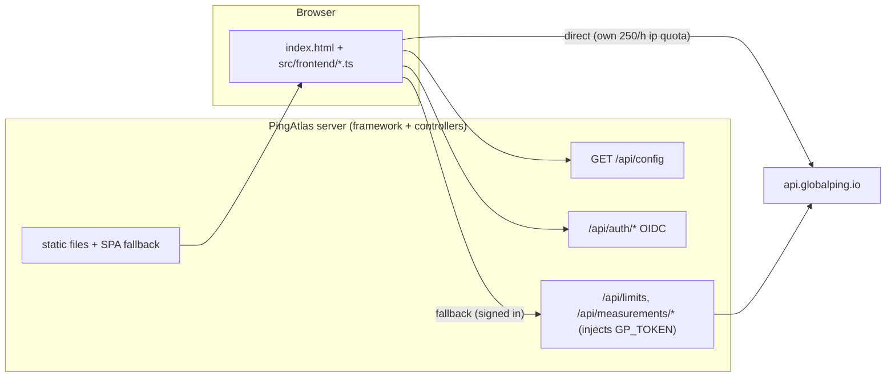

# PingAtlas — Design Notes

Implementation plan and design record for the PingAtlas online network-testing service.

## Goal

A web service that runs Globalping measurements from a browser-selected set of probes and renders the results **without a map**: a probe list plus the full per-probe detail.

| # | Requirement | Decision |
| --- | --- | --- |
| 1 | Test features comparable to globalping.io | All 5 measurement types + the full option set of each |
| 2 | Window design similar to `lg.nxtrace.org` | Two-column layout (form panel + result panel), same meter styling cues |
| 3 | No map (Mainland China map-approval number) | Only the probe list and the result details are rendered |
| 4 | Commands go from the browser to globalping.io using the visitor's anonymous 250/h quota, shown bottom-left | Duplicated by the `ip` quota meter and by every measurement response's `X-RateLimit-*` headers |
| 5 | Reuse the `node-server-falsework` framework, the `LibreTranslate-FrontPage` OIDC flow, no front-end framework, PWA | Framework copied verbatim wherever possible; hand-written TypeScript SPA; `manifest.webmanifest` + service worker |
| 6 | After sign-in the server-side token may be used as a fallback; both quotas shown bottom-left | Backend `/api/*` proxy with token injection, no quota accounting |

## Framework boundary

Files are copied from `node-server-falsework`. The goal is to keep the framework byte-identical
so future framework updates can be merged in; application behaviour lives in new files instead.

### Copied verbatim (safe to re-sync from the framework)

```
config/esbuild.common.ts     config/esbuild.dev.ts     config/tsconfig.json
tsconfig.json                pnpm-workspace.yaml       .vscode/settings.json
src/controller/controller.ts           src/controller/main.controller.ts
src/entry/index.ts                     src/exceptions/basic.exception.ts
src/main/main.ts                       src/middleware/api.middleware.ts
src/middleware/parameter.middleware.ts src/middleware/trace.middleware.ts
src/utils/interface.ts                 src/utils/logger.ts
src/utils/router.ts                    src/utils/utils.ts
src/utils/venation/driver.ts           src/utils/venation/index.ts
src/utils/venation/transport.ts
```

### Adapted from the framework (re-diff before re-syncing)

| File | Change |
| --- | --- |
| `package.json` | Project name/version, dev script runs the front-end watcher too, extra deps (`openid-client`, `jose`, Jest tool-chain), extra scripts (`test`, `test:watch`, `test:coverage`) |
| `src/config/config.ts` | Globalping / OIDC / session configuration instead of the framework demo values |
| `src/router/index.ts` | `/api/*` routes plus the front-end static catch-all (the framework's `/test` router was dropped) |
| `config/esbuild.prod.ts` | Adds the browser bundle (content-hashed entry) and the `public/` → `dist/public/` copy |
| `.env.example` | Project-specific variables |
| `README.md`, `README.zh-Hans.md`, `PLAN.md` | Project documentation |
| `eslint.config.mjs` | Ignores `coverage/**` and relaxes `node/prefer-global/*` inside `test/**` |
| `pnpm-workspace.yaml` | `allowBuilds` explicitly set for `@parcel/watcher` / `unrs-resolver` (optional native accelerators of Jest; skipping the build falls back to pure JS) |

`config/esbuild.common.ts` is shared unchanged with `LibreTranslate-FrontPage` (both projects export
runtime dependencies as ESM externals); it differs from the framework's own copy, which targets a
different build mode.

### Application code (new; the framework is untouched here)

```
src/service/oidc.ts                        src/utils/{cookie,session,respond,request,mime}.ts
src/middleware/session.middleware.ts       src/controller/{auth,frontend}.controller.ts
src/controller/globalping.controller.ts     # the only new business backend
src/utils/probe-index.ts                    # probe-index builder shared by backend & tests
src/frontend/{main,api,auth,quota,measure,results,i18n,theme,ui,types}.ts
src/frontend/location-suggest.ts            # location autocomplete combobox
public/{index.html,sw.js,manifest.webmanifest,favicon.svg,css/style.css,locales/*.json}
test/{backend,frontend,integration,service,helpers,setup}/   jest.config.mjs   tsconfig.test.json
```

Removed framework demo files: `src/controller/test.controller.ts`, `src/router/test.ts`.

## Architecture



## Globalping API contract (verified against the live API and the OpenAPI spec)

- Base `https://api.globalping.io`
- `GET /v1/limits` — **does not consume quota**, safe to poll every 5 minutes
- `POST /v1/measurements` — `202` + `Location`; anonymous `limit <= 50`, authenticated `limit <= 500`
- `GET /v1/measurements/{id}` — publicly readable, does not consume create-quota
- `GET /v1/probes` — probe catalogue
- CORS is fully open and `X-RateLimit-*`, `X-Request-Cost`, `X-Credits-*`, `Retry-After` are exposed → the browser can call the API directly
- `inProgressUpdates: true` only streams the first 5 results in real time
- Polling is throttled: wait 500 ms after the previous response, at most 2 requests/second per measurement
- `limit` semantics: top level = shared across locations (default 1); inside a location object = per-location. The two are mutually exclusive
- `locations` may be a previous measurement id to reuse its probe set
- `timeout` is 5–30 s; the client adds a 15 s grace period
- Error body: `{ error: { type, message, params? }, links? }`

## Quota strategy

State model:

- `localQuota` — `{ status, limit, remaining, reset, type: 'ip' }`, read from the direct API
- `proxyQuota` — `type: 'user'`, may carry `credits.remaining`, read through `/api/limits`
- `modePreference` — `'auto' | 'proxy'`, persisted in `localStorage` key `pa-quota-preference`

Routing decision, evaluated per measurement:

1. direct API unreachable → proxy (or report "no quota channel available")
2. `localQuota.remaining <= 0` → proxy
3. `probeCount > 50` and the proxy is available → proxy
4. `modePreference === 'proxy'` → proxy
5. otherwise → direct

Refresh policy:

| Trigger | Behaviour |
| --- | --- |
| Start-up / sign-in state change | immediate `GET /v1/limits` |
| Heartbeat | every 5 minutes |
| `remaining === 0` | re-check precisely at `reset + 2 s` |
| Tab returns to foreground | re-check if the last check is older than 30 s |
| Any measurement response | update in place from `X-RateLimit-*` |

Reset detection relies on `remaining` going from 0 to a positive value (not on the clock), and
resets `modePreference` to `'auto'` with a toast. The meter is a `<button>`, so the visitor can
force the proxy path at any time; the automatic switch-back overrides that preference.

A persisted `'proxy'` preference is only carried over when the local quota is exhausted: after a
page load the first local-quota result decides — with quota left the preference returns to `'auto'`
(silently, since this happens on every refresh), and only an exhausted quota keeps `'proxy'`. An
explicit `setPreference()` call during the session outranks that load-time default.

Probe-count limits: `ANONYMOUS_MAX_PROBES = 50`, `AUTHENTICATED_MAX_PROBES = 500`,
`UI_DEFAULT_PROBES = 3`; the preset list is `1, 3, 5, 10, 25, 50, 100, 500`.

## Backend API

All `/api/*` responses are raw JSON (no framework `{ success, code, result }` envelope) so upstream
error bodies and status codes can be passed through unchanged.

| Method | Path | Auth | Description |
| --- | --- | --- | --- |
| `GET` | `/api/config` | public | `{ apiUrl, proxyAvailable, maxProbes }` |
| `GET` | `/api/auth/status` | public | `{ loggedIn, authEnabled, user }` |
| `GET` | `/api/auth/login` | public | 302 → IdP |
| `GET` | `/api/auth/callback` | public | code exchange → session cookie → `/` |
| `GET` | `/api/auth/logout` | public | clear session, optional IdP end-session redirect |
| `GET` | `/api/limits` | login + `GP_TOKEN` | proxied `GET /v1/limits` |
| `GET` | `/api/probes` | public | de-duplicated probe index for location autocomplete (no token, no quota) |
| `POST` | `/api/measurements` | login + `GP_TOKEN` | proxied `POST /v1/measurements` |
| `GET` | `/api/measurements/:id` | login + `GP_TOKEN` | proxied `GET /v1/measurements/{id}` |

`GP_TOKEN` is never sent to the browser. Upstream errors are mapped to `502 { error: { type: 'upstream_error' } }`
so the front end can render them with the same code path as native API errors.

`GET /api/probes` is the one upstream call that carries no token: it fetches `GET /v1/probes` once and
folds the 5000+ entries (2.1 MB) into a de-duplicated index that `src/utils/probe-index.ts` builds —
roughly 121 countries / 21 regions / 1047 cities / 1464 networks / 1285 tags in ~92 KB of JSON.
A module-level cache serves it for 5 minutes (`PROBE_INDEX_TTL`) and the response is sent with
`Cache-Control: public, max-age=300` plus an `X-Probe-Index: hit|miss` marker. A stale copy is served
when the upstream call fails; with no copy at all the endpoint answers `502` and the front end
silently disables suggestions.

## Front-end structure

- Plain static markup in `public/index.html`, translated in place by `applyI18n()` using
  `data-i18n` / `data-i18n-placeholder` / `data-i18n-title` / `data-i18n-aria-label`
- `src/frontend/*.ts` compiled into a single bundle by esbuild (`main-<hash>.js` in production,
  `main.js` in watch mode); `public/index.html` and `public/sw.js` record the hashed name
- i18n dictionaries at `public/locales/{en,zh-Hans}.json`, resolved at runtime, with `en` as the
  fallback; switching language reloads the page
- Theme follows `prefers-color-scheme` and can be overridden; the choice is persisted
- The top-right user area (language switcher, user chip, sign-in / sign-out buttons) and the
  sign-in / sign-out modals follow one shared visual spec. Their rules live in the `.topbar-actions`
  / `.modal-dialog` scoped blocks of `public/css/style.css`, which keeps the form and result areas
  on this project's own `.btn` / `.select` styling. Keep the two areas in sync when either changes
- Service worker caches the app shell network-first and skips `/api/` and cross-origin requests
- `src/frontend/location-suggest.ts` turns each location input into an ARIA combobox. The probe index
  is loaded lazily on first focus, then cached in memory → `localStorage` (`pa-probe-index`, 24 h TTL,
  background refresh after the TTL, discarded after 3 days) → the network. Scoring is
  exact > prefix > substring > subsequence (`Fuzho` → `Fuzhou`); whitespace splits the query into
  AND-ed tokens, probe count breaks ties, and personal `u-*` tags take a 500-point penalty. The panel
  is appended to `document.body` with `position: fixed` (the form panel is a scroll container that
  would clip it), re-positions on scroll/resize, and flips above the input when the space below is
  under `MIN_PANEL_HEIGHT`. `mousedown` is cancelled on options so selection does not blur the input,
  and `Enter` is consumed while an option is highlighted so it never submits the form
- Result tables live in `.table-wrap`; below 620px the header row is hidden visually (still exposed
  to assistive tech) and each row becomes a flex card driven by `data-label` pseudo-element labels.
  Hostnames wrap, numeric columns stay single-line, and the four MTR stat columns share one row —
  the page never scrolls horizontally. Touch targets are enlarged below 620px and on any coarse
  pointer device

## Testing

- Jest 30 (ESM + ts-jest, `node --experimental-vm-modules`) with `test/**` as the only root;
  `jest.config.mjs` maps `../../package.json` to a TypeScript shim (JSON named exports do not work
  under ESM) and `test/setup/env.ts` pins a baseline environment before every suite
- `test/backend` — framework glue: router, venation driver/transport, config, logger, cookie,
  session, request/respond/mime helpers; `test/service` — OIDC; `test/frontend` — jsdom suites for
  every SPA module plus two stylesheet-level suites: `responsive.test.ts` parses
  `public/css/style.css` and asserts the narrow-screen table rules stay in place, and
  `quota-note.test.ts` pins the quota-meter note layout (direct-child flex items with a horizontal
  gap rather than pseudo-element punctuation) and the short mode labels, while
  `footer-credit.test.ts` renders the footer attribution from the real locale files and pins the
  three outbound links; `test/integration` — controllers plus an end-to-end run against a real
  `node:http` server started from `createServer()`
- `test/backend/probe-index.test.ts` covers the index builder (de-duplication, count aggregation,
  ordering, malformed input) and `test/frontend/location-suggest.test.ts` covers autocomplete end to
  end: scoring tiers, subsequence matching, diacritic/case folding, index caching & TTL behaviour,
  panel positioning/flipping and every keyboard interaction. jsdom has no global `Response`, so the
  suite injects a minimal stand-in, and `ui` is mocked with deterministic English country names
  because the real `countryName()` depends on the host locale
- 33 suites / 840 cases, ~98.9% lines. Remaining uncovered branches are defensive guards that no
  code path can reach (e.g. `compact()`'s empty-object skip, `buildMeasurementOptions()`'s
  type-guarded `default`, `pollMeasurement()`'s second token check) or need real navigation
  (`window.location.href` assignments, which jsdom cannot perform)
- `test/frontend/*` files must keep `/** @jest-environment jsdom */` as the very first lines:
  ESLint's import sorting will move a type-only import above the docblock, and Jest then silently
  falls back to the `node` environment

## Build & deploy

- `pnpm build` → `dist/index.js` (backend, ESM) + `dist/public/` (front end incl. hashed assets)
- `Dockerfile` — `node:24-alpine`, `pnpm install --prod`, copies `dist/`, exposes `3001`
- `.gitlab-ci.yml` — typecheck, lint, test, build, then build & push the image on the default branch only

## Scope & non-goals

- OIDC sign-in only; no local accounts, no per-user Globalping token input
- No server-side quota accounting or measurement persistence
- No map, no measurement history, no share links
- Sessions are stateless and signed with `SESSION_SECRET`; a restart invalidates them
